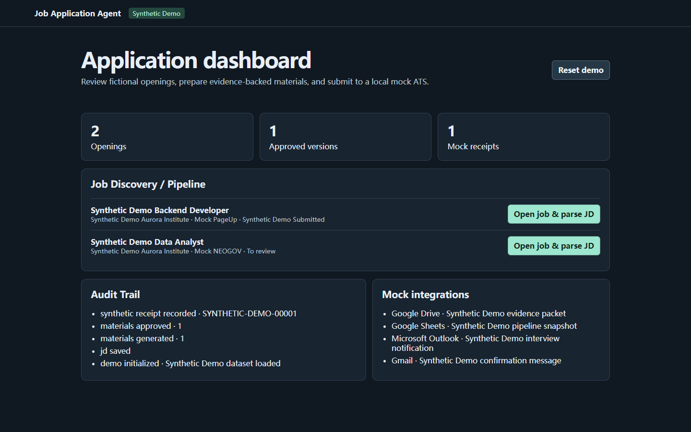

# Job Application Agent — Synthetic Demo

A Python and SQLite portfolio application that follows a fictional job from JD parsing to a local Playwright receipt. Every job, organization, applicant, address and receipt in the demonstration is **Synthetic Demo**.



## Run locally

Use Python 3.11.

```powershell
.\start.ps1 -Setup
```

```bash
python -m venv .venv
source .venv/bin/activate
python -m pip install -r requirements.txt
python -m playwright install chromium
python -m app.server
```

Open `http://127.0.0.1:8768`. **Reset demo** creates a fresh dataset in the isolated runtime directory. No OAuth credentials or third-party accounts are required.

## Engineering

- The JD parser separates required and preferred criteria. Evidence coverage links matches to approved fact IDs and source locators. Qualification checks identify items that need review.
- The materials engine generates PDF and DOCX for the fictional applicant, verifies PDF layout, and gates attachments on explicit approval.
- The Playwright runner drives local PageUp and NEOGOV fixtures. It pauses for unknown options, resumes from SQLite checkpoints, and requires explicit confirmation with the current review token before producing a mock receipt.
- Receipt uniqueness and startup-independent reconciliation make repeated reads and submission attempts safe. Pipeline status and audit history expose the mock outcome.
- The OAuth provider architecture is represented by read-only synthetic provider adapters. This build contains no live OAuth exchange, inbox scan, or live ATS browser driver.

See [the demo walkthrough](DEMO_GUIDE.md), [architecture](ARCHITECTURE.md), and [security model](SECURITY.md).

## Tests

```bash
python -m unittest discover -s tests -v
python tools/scan_release.py
```

## Hosting configuration

The Docker image runs the app as a non-root user and listens on `0.0.0.0` using the host's `PORT` (default `10000`). The Render Blueprint selects Free, disables automatic deploys, and probes `GET /healthz`. The probe checks SQLite readiness without running the browser workflow. Visitors receive separate synthetic databases. Restarting or spinning down the service discards demo progress and the next visit initializes fresh data.

## License

[MIT](LICENSE) © 2026 Hairu Wen.
